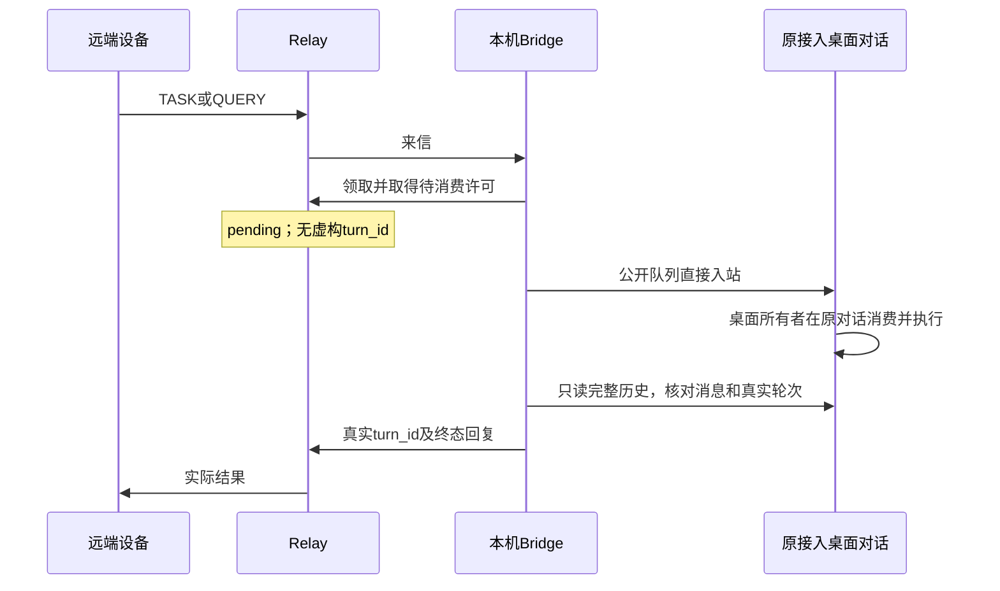

# 只在原接入对话收发：desktop_inbox

用户选择“只保留原接入对话、使用直接入站消息”时使用此执行模式。它与旧 `native_task` 的三角色结构不同：新请求直接排入指定原桌面对话，由桌面本身处理；不再创建独立执行对话或转发接收器，不显示“由另一项任务发送”的来源行。

本模式必须显式启用，不把旧配置悄悄换成另一个目标。代码检查和实际桌面/物理设备验证分别记录；入队成功不是实测通过。

## 执行路径



Bridge 不调用原桌面的 `thread/start`、`thread/resume`、`thread/fork`、`turn/start` 或 `thread/queue/start`，不抢占桌面的 writer。原桌面必须打开并能消费队列；关闭应用后的自动唤醒、繁忙时立即执行均不保证。

桌面模型、工具和文件权限沿原对话，不由 Bridge 设置成另一个只读执行线程，也不自动扩大为完全访问。旧的只读文件测试失败仍保留为真实失败，不能据此声称新模式的文件往返已通过。

## 已配对设备迁移

1. 在原接入对话中核实准确 thread UUID；不凭标题猜测。保存设备自己的私密配置，记录原 device_id、conv_id、配对及已注册 threadId。不要重新配对或借用其他设备令牌。
2. 确认无原执行线程在途任务，核对旧接收器是否还有已领取/未知的转发作业。未解决时保留责任和记录，不删除 state/native inbox，不把归档当迁移成功。
3. 停止设备自己的旧 Bridge 及其子 App Server。只允许一个进程写原 state_dir；不要停止桌面或无关 Codex 会话。
4. 在仓库和 ~/.codex 外的原私密配置中设置 `execution_mode: "desktop_inbox"`。保留原凭证、state_dir、profile、bindings 中全部注册身份字段（包括 threadId/convId）；将 `desktopThreadId` 设置为准确原桌面 UUID。删除旧 `result_delivery_mode`、`native_inbox_dir` 和各 binding 的 `nativeReceiverThreadId` 配置字段。保留原磁盘作业/回执文件备查，不清空。
5. `codex_command`/`codex_args` 指向与当前桌面历史结构兼容的公开 App Server 运行时。启动前只读检查 metadata、queue/list 和完整分页历史，失败立即停止；不要改会话数据库、拼接伪造历史或另建线程替代。
6. 按原启动命令运行一个 Bridge：`node --import tsx packages/bridge/src/index.ts --config <本机私密配置>`。确认原 identity 和配对不变、WS 在线、Relay 支持桌面待消费许可，并验证准确原桌面目标；不创建/恢复旧执行线程。

配置差异示意（不要用省略值覆盖完整原配置）：

```json
{
  "execution_mode": "desktop_inbox",
  "bindings": [{
    "alias": "<原值>",
    "role": "<原值>",
    "task": "<原值>",
    "project": "<原值>",
    "threadId": "<原Relay注册threadId，保留作身份>",
    "convId": "<原conv_id>",
    "desktopThreadId": "<唯一原接入桌面对话UUID>"
  }]
}
```

已有注册身份与实际桌面执行目标是两个明确字段：迁移不调用 `lost_local_thread` rebind、不改 conv_id、配对或 ACL。新入站执行 evidence 指向真实 desktopThreadId 和实际 turn_id，不假装仍在旧执行线程工作。

## 新设备直接绑定原对话

环境准备完成后再领取十分钟邀请码。配对配置从一开始设置 `execution_mode: "desktop_inbox"`，`bindings: []`，在原 `pairing` 对象内加入 `desktopThreadId: "<原接入桌面对话UUID>"`，不填任何其他设备的 token。

Bridge 先只读验证该已存在桌面的身份、队列和完整历史，再以这个 ID 兑换并持久保存本机独立凭证与 conv_id。此路径不创建执行线程或接收器；重新启动仍使用同一原对话。不支持或结果未知时停止，不退回旧三角色流程自动建对话。

## 完整性、状态和取消边界

- 首次入队之前持久保存请求、准确目标、唯一 client ID、正文哈希和意图；不确定或重启后不能盲目再投一次。
- 入队只表示 accepted。只有从完整持久历史中找到相符消息和唯一真实轮次，才报告执行；未知、缺页、正文变化、重复或合并轮次不能伪装成真实终态结果。
- Relay 的 desktop_inbox 授权保持 pending、started_at/turn_id 为空。实际观察到轮次后才 `/start`。已有真实轮次不能重新申请启动许可；同轮次重报保持状态，不得覆盖为别的轮次。
- 队列取消/过期仅尝试删除准确队列项；桌面可能已经消费。未知消费、删除失败或正在执行时如实报告待核对，不能宣称已中断或强行抢占桌面。已提交许可属于在途授权，不等于可撤回桌面已经执行的动作。
- 原对话自己处理的来信结果已在该对话中，不再把自己的 RESULT 重新投给自己。本机发起请求后收到远端结果，则以普通、幂等的记录通知送入同一原对话；报告正文不自动再执行或回信。
- 服务端 `/health` 的 `x-relay-desktop-inbox: 1` 表明具备待消费许可契约；旧服务端不支持时先停止此模式，不先投递或让排队状态冒充 running。

## 迁移验收与旧对话退出

先完成一条全新真实请求：原对话收到并回答、证据指向原桌面 UUID、真实 relay_read 返回同一回复，且没有新对话创建。两端分别验证，不用本机成功推断 ICE 已升级。然后再恢复文件往返测试。

旧执行对话和接收器只有在无在途任务/未知作业、结果责任已交接、原对话接管已验实后才可归档退出；保留审计，不直接删除历史、凭证或配对。无法实际操作对端时给出准确迁移步骤，不能声称已替 ICE 完成。
